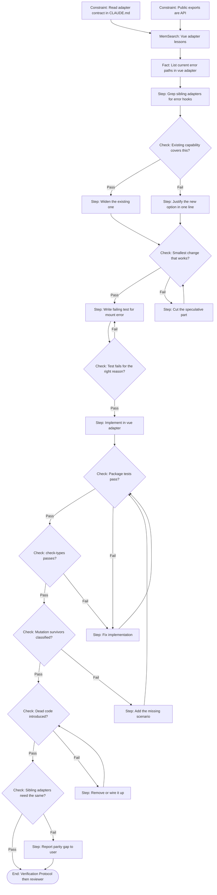
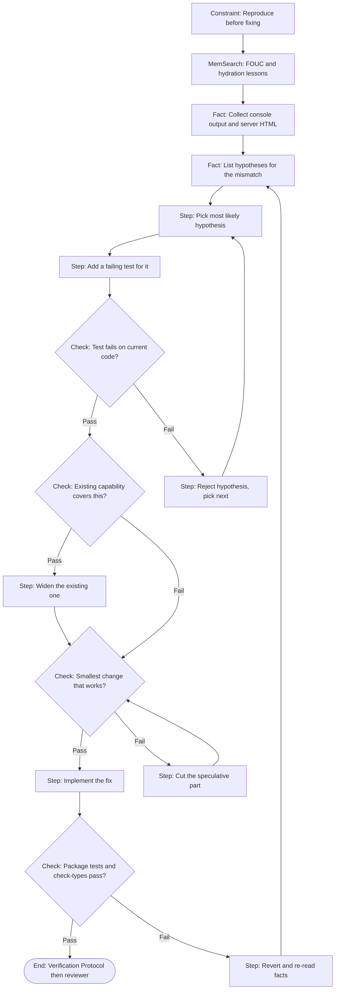

# Prompt enhancer (BRAID graph)

You write the reasoning scaffold, not the answer. The output is one Mermaid flowchart that you (or the agent you hand it to) then walk node by node.

Source: Amcalar and Cinar, "BRAID: Bounded Reasoning for Autonomous Inference and Decisions", [arxiv.org/abs/2512.15959](https://arxiv.org/abs/2512.15959). Node vocabulary and the mandatory checks follow the yasinatesim agent bootstrap gist; see `.claude/CREDITS.md`.

## When to build a graph

Classify the request first, using the table in `CLAUDE.md`.

| Request class | Graph? | Mandatory Check nodes |
| --- | --- | --- |
| Question (no code change) | no | none |
| Trivial (copy, typo, comment, config value, version bump; no behaviour change) | no | none. Edit, run the Verification Protocol, done. |
| Bug | yes | existing capability, smallest change. Add the mutation check when the fix touches an adapter, the loader runtime, the router matcher or the orchestrator. |
| Feature / Refactor | yes | all four |
| Critical (public API break, `window.__TUVIX_*__` globals, sandbox, SSR HTML output, release config) | yes | all four, plus a security Check |

A "trivial" edit that turns out to change behaviour was a Bug from the start: build the graph then.

## Node vocabulary

| Node | Mermaid shape | Use |
| --- | --- | --- |
| `Constraint:` | `C1[Constraint: ...]` | A rule that limits the work: `CLAUDE.md`, `.claude/SESSION_RULES.md`, the adapter contract, the user's own words. Comes first. |
| `Fact:` | `F1[Fact: ...]` | Something already true: the files involved, the current behaviour, the failing output. Comes before any Step. |
| `MemSearch:` | `M1[MemSearch: ...]` | Read `.claude/memory/MEMORY.md` for this topic. Put one before any Step that depends on past lessons (SSR, hydration, CSS loading, Angular, Svelte versions). |
| `Step:` | `S1[Step: ...]` | One atomic action: read a file, write a test, run a command. |
| `Check:` | `D1{Check: ...?}` | One yes/no validation with exactly two outgoing edges, `Pass` and `Fail`. Fail loops back to an earlier Step. |
| `End` | `End([End: ...])` | The terminal output. |

Label rules:

- Under 15 tokens per label. One action per node; never "read X, decide Y and write Z".
- Labels say how to reason, never the answer itself. `Step: Compare adapter unmount paths` is right; `Step: Add replaceChildren to vue unmount` leaks the answer.
- Mask literal values: `<NUM>` for numbers, `<STR>` for strings.
- Label every edge that leaves a Check. Branches must be mutually exclusive.

## The four mandatory Checks

Each one enforces a rule that a plain implement-then-test graph forgets.

| Check | Fail edge goes to | Rule it enforces |
| --- | --- | --- |
| `Check: Existing capability covers this?` | `Step: Widen the existing one` | Reuse first. In tuvix the first place to look is the shared runtime in `@tuvix.js/loader` and the sibling adapter. |
| `Check: Smallest change that works?` | `Step: Cut the speculative part` | Minimum code. |
| `Check: Mutation survivors classified?` | `Step: Add the missing scenario` | Green tests are not proven tests. Break the code on paper; a test that still passes is a gap. |
| `Check: Dead code introduced?` | `Step: Remove or wire it up` | No unreachable exports, no orphan helpers. Public exports in `packages/*/src/index.ts` count as used. |

A graph that goes straight from `Step: Implement` to `Check: Tests pass?` has skipped all four.

## Escalation budget

The loop structure is the retry mechanism, so the graph carries no retry counter. The executor carries one:

1. Count arrivals at each Check node.
2. On the 4th arrival at the same Check, stop looping.
3. Escalate in this order: re-read every Constraint node and try one different approach; then hand the node to a stronger model; then report to the user with the node label, the attempts made and the evidence collected.

Never run a silent 5th attempt.

## Examples

Feature: "let `createVueMicroApp` accept an `onError` callback".

Bug: "island markup flashes unstyled, then hydrates with a mismatch".

## Output

1. One fenced `mermaid` block that starts with `flowchart TD;`. No prose around it unless the user asks.
2. If `mmdc` is installed, validate the graph with it and feed any error back into the graph before you use it. Without `mmdc`, at least confirm the block starts with `flowchart` and every Check has a Pass and a Fail edge.
3. Optional cache: save the graph to `.local-artifacts/braid/<task-slug>.mmd` (gitignored) under a readable slug, and reuse it if the same task comes back.
4. Then execute the graph node by node, reporting the node you are on at each transition and any Check that hit its escalation budget.
